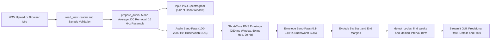

# Respiration Rate Estimator

An audio digital signal processing (DSP) web application for contactless respiration-rate estimation from recorded breathing sounds using Python, Streamlit, NumPy, SciPy, Matplotlib and SoundFile.

## Features

- WAV file upload and browser-based microphone recording (`st.audio_input`), accepting mono or stereo WAV-family files (`WAV`, `WAVEX`, `RF64`) at 8,000 Hz or higher, 30–120 seconds long and up to 50 MiB.
- Original audio metadata inspection (duration, sample rate, channel count), in-app playback and unmodified **Save original WAV** download.
- Non-destructive preprocessing that retains original sample amplitudes for quality checks, averages stereo channels to mono, subtracts DC offset and resamples to 16,000 Hz with polyphase FIR anti-alias filtering (`resample_poly`).
- Dual-band zero-phase Butterworth IIR filtering in second-order sections (`sosfiltfilt`): an acoustic band-pass (100–2000 Hz) followed by a slow breathing-rhythm band-pass (0.1–0.8 Hz).
- Short-time RMS envelope extraction using 250 ms windows every 50 ms (20 Hz envelope sample rate) with center-frame timestamps.
- Full-clip filtering prior to excluding five-second start and end margins from cycle detection, avoiding artificial crop edges inside the analyzed region.
- Interactive diagnostic plots: min/max-binned original and filtered waveforms, input audio PSD spectrogram (512-sample Hann window, 256-sample overlap), and aligned raw RMS vs. signed filtered envelope with candidate cycle markers.
- Candidate peak detection (`scipy.signal.find_peaks`) with an adjustable prominence fraction (`0.05`–`0.80`, default `0.15`), minimum 1.25 s peak spacing and median-interval BPM calculation.
- Explicit handling of flat envelopes, insufficient markers, out-of-range rates and high interval variability, reporting `Unavailable` with diagnostic reasons rather than clamping or substituting zero BPM.
- Automatic clearing of cached results whenever the audio source, uploaded/recorded audio or detection prominence setting changes.

## Architecture



The application operates offline on complete recordings rather than real-time streams. `dsp.py` runs independently of Streamlit: it validates decoded WAV samples, preprocesses them to a uniform 16,000 Hz mono representation without peak normalization, filters the audible band to suppress low-frequency rumble and high-frequency noise, extracts the slow amplitude envelope, filters that envelope over the target respiration bandwidth and identifies candidate cycle peaks inside the central interval. `app.py` manages session state, playback, downloads, controls and Matplotlib visualizations.

## DSP pipeline and configuration

All baseline processing parameters are centralized in `AUDIO_CONFIG` inside [dsp.py](dsp.py) and included in every analysis result dictionary.

| Parameter | Value | Purpose |
| --- | --- | --- |
| Processing sample rate | `16000` Hz | Uniform internal rate for filtering and frame sizing |
| Minimum source sample rate | `8000` Hz | Ensures sufficient acoustic bandwidth before resampling |
| Accepted clip duration | `30`–`120` s (~60 s recommended) | Captures multiple breathing cycles beyond edge margins |
| Upload limit and channels | `50` MiB; `1` (mono) or `2` (stereo) | Enforced in header validation and `.streamlit/config.toml` |
| Silence RMS threshold | `1e-6` | Rejects silent or zero-energy inputs after DC removal |
| Audio band-pass | `100.0`–`2000.0` Hz | Separates audible breathing sound energy from rumble and hiss |
| Envelope band-pass | `0.1`–`0.8` Hz | Targets slow rhythm repetitions corresponding to 6–48 BPM |
| Filter design and application | Butterworth `N=2`, `output="sos"`, `sosfiltfilt` | Fourth-order band-pass per pass; effective response order eight |
| RMS window and hop | `0.25` s window (`4000` samples), `0.05` s hop (`800` samples) | Produces a `20` Hz envelope with window-center timestamps |
| Edge exclusion margin | `5.0` s at clip start and end | Excludes `[0, 5)` s and `[duration - 5, duration]` s after full-clip filtering |
| Flat-envelope threshold | `0.01` (`1%` of median central RMS) | Flags nearly constant envelopes instead of fitting filter edge artifacts |
| Minimum peak spacing | `1.25` s (`25` envelope samples at `20` Hz) | Derived from the `0.8` Hz (`48` BPM) upper search cutoff |
| Prominence fraction | `0.15` default (`0.05`–`0.80` slider) | Fraction of the central filtered envelope's 95th-to-5th percentile span |
| Minimum candidate markers | `3` markers (`2` intervals) | Required before computing a median-interval BPM |
| Interval variability warning | Coefficient of variation `> 0.2` | Warns when candidate spacing varies substantially |

Because SciPy's `butter(N=2, ..., btype="bandpass")` designs a fourth-order band-pass filter per pass, applying it forward and backward via `sosfiltfilt` squares the magnitude response, yields zero phase distortion across the completed clip, and gives an effective filter order of eight. The specified cutoff frequencies act as `-3 dB` points in a single pass and approximately `-6 dB` points after forward-backward application.

For visualization in [app.py](app.py), waveforms use extrema-preserving min/max display bins (`ceil(N / 3000)` samples per bin) so plotting never downsamples the analysis signal. The spectrogram is computed from the DC-removed 16,000 Hz prepared audio before band-pass filtering using 512-sample Hann windows, 256-sample overlap, density scaling and an 80 dB dynamic display range.

## Cycle detection and rate semantics

- **Candidate detection:** `detect_cycles` evaluates `scipy.signal.find_peaks` strictly on the central filtered envelope slice (`5.0 <= t < duration - 5.0`), then maps peak indices back to original clip timestamps and projects them onto the raw RMS plot for visual comparison.
- **Rate formula:** When at least three candidate peaks are found, `peak_bpm = 60 / median(diff(peak_times_s))`. Using the median reduces sensitivity to a single missed breath or outlier gap, and the interval coefficient of variation (`std / mean`) is reported alongside the marker timestamps.
- **Unavailable results:** If the central RMS envelope is flat, the filtered envelope percentile span is negligible, fewer than three markers are detected, or the resulting rate falls outside `6`–`48` BPM, `peak_bpm` is returned as `None` and displayed as `Unavailable` with the underlying reason. Out-of-range rates are never clamped to boundary values.
- **Provisional interpretation:** One complete breathing cycle consists of both inhalation and exhalation, which can appear as two separate acoustic bursts per breath. Detected peaks represent candidate events rather than verified full breaths, and the pipeline intentionally avoids automatic halving or heuristic post-hoc correction.

## Input validation and audio handling

`read_wav` inspects the WAV header before loading audio samples and rejects empty payloads, payloads exceeding 50 MiB, non-WAV formats, zero-sample files, channel counts other than 1 or 2, sample rates below 8,000 Hz, durations outside 30–120 seconds, truncated files and non-finite (`NaN`/`Inf`) samples.

`prepare_audio` averages stereo channels without peak normalization, removes the mono DC offset, and verifies that signal energy exceeds `1e-6` RMS both before and after polyphase resampling to 16,000 Hz. Another `1e-6` RMS check is performed after the 100–2000 Hz audio band-pass. Recording capture and uploads stay inside the active Streamlit session; use **Save original WAV** in the UI to download the unmodified original audio bytes.

## Repository layout

```text
app.py                         Streamlit web interface, state management, playback and plots
dsp.py                         Independent DSP configuration, I/O validation, filtering and peak BPM
requirements.txt               Python runtime dependencies
.streamlit/config.toml         Server upload limit (50 MiB) and light UI theme
tools/prepare_midterm_demo.py  Deterministic acoustic test-signal generator and pipeline runner
tests/                         Unit, DSP processing, peak-estimation and Streamlit AppTest suites
data/                          Local directories for pilot recordings and generated test signals
docs/                          Technical blueprint, guides, templates, screenshots and verification logs
```

## Get the source

```bash
git clone https://github.com/yashasrao05/breathwave.git
cd breathwave
```

## Run locally

1. Install Python 3.11 or 3.12.
2. Create and populate a virtual environment from the repository root (PowerShell example):

```powershell
python -m venv .venv
.\.venv\Scripts\python.exe -m pip install -r requirements.txt
```

3. Launch the Streamlit server:

```powershell
.\.venv\Scripts\python.exe -m streamlit run app.py
```

4. Open `http://localhost:8501` in a browser if it does not open automatically. Press `Ctrl+C` in the terminal to stop the server.

For macOS/Linux shells, replace `.\.venv\Scripts\python.exe` with `./.venv/bin/python`.

## Using the application

1. Choose **Upload WAV** to load an existing recording or **Record audio** to capture audio through the browser microphone (grant microphone permission when prompted).
2. Review the detected duration, sample rate and channel count, and verify audio output using the built-in player. Optionally click **Save original WAV** to download and rename the unprocessed clip before recording another take.
3. Adjust **Peak prominence fraction** under **Detection settings** if needed (`0.15` by default). Changing either the input audio or the prominence slider clears any previous analysis result.
4. Click **Analyze audio** to run preprocessing, filtering, RMS envelope extraction and candidate cycle detection.
5. Inspect the provisional BPM, candidate marker count, analyzed duration, **Cycle detection details**, **Filter and envelope settings**, and the three diagnostic plot panels. Shaded gray intervals indicate the first and last five seconds excluded from cycle detection.

## Generated test signals

To generate deterministic 60-second, 16,000 Hz mono FLOAT WAV acoustic test signals (using an amplitude-modulated 700 Hz carrier) and inspect their pipeline outputs, run:

```powershell
.\.venv\Scripts\python.exe tools/prepare_midterm_demo.py
```

This writes six test clips into `data/midterm_engineering/` (clean modulation at 12, 18 and 24 BPM; a 12 BPM double-burst stress case; an unmodulated constant carrier; and silence) along with measured outputs in `data/midterm_engineering/latest-run.json`. These files are deterministic engineering test fixtures for verifying DSP behavior, not recordings of human breathing.

## Verification and limitations

Run the automated test suite and dependency integrity check from the repository root:

```powershell
.\.venv\Scripts\python.exe -m unittest discover -s tests -v
.\.venv\Scripts\python.exe -m pip check
```

Automated coverage across [tests/](tests/) includes:

- **Audio validation and preprocessing (`tests/test_audio.py`):** mono and stereo WAV decoding across 8,000–48,000 Hz, DC removal without mutating original amplitudes, anti-aliased downsampling, silence/cancelling-stereo rejection, duration/rate bounds, corrupt headers and non-finite samples.
- **Filtering and RMS extraction (`tests/test_processing.py`):** RMS frame counts and center timestamps, audio and envelope band-pass gain/attenuation, survival of slow amplitude modulations (0.2, 0.3, 0.4 Hz) through the full pipeline, flat-envelope warnings and invalid filter arguments.
- **Peak estimation (`tests/test_estimation.py`):** known-rate checks at 12, 18 and 24 BPM, median-interval robustness to a long gap, minimum peak spacing, insufficient-marker and out-of-range `Unavailable` behavior, prominence overrides and the double-burst harmonic limitation.
- **GUI regression (`tests/test_app.py`):** Streamlit `AppTest` checks for upload/record mode switching, state clearing on input or prominence changes, metadata display, figure rendering, `Save original WAV` preservation and silent/corrupt input errors.

Known limitations and scope notes:

- **Single estimator and unvalidated real-world accuracy:** Rate estimation currently relies solely on candidate envelope peak intervals. Real human breathing recordings, manual cycle annotations, autocorrelation comparison and noise-robustness sweeps are not yet evaluated in the codebase.
- **Double-counting susceptibility:** Audible inhale and exhale bursts within a single breath can trigger two candidate markers per cycle (as demonstrated by the 12 BPM double-burst stress fixture yielding 24 BPM).
- **Hardware checks:** Automated tests exercise `st.audio_input` with staged WAV bytes; live microphone capture, browser file downloads and speaker playback depend on the host browser and audio hardware.
- **Educational scope:** This software is an educational DSP demonstration and is not intended for medical or clinical diagnosis.

## Contributors

- **Sachidanand N C** ([GitHub](https://github.com/sachidanandnc))
- **yashasrao05** ([GitHub](https://github.com/yashasrao05))

## License

No license file is currently included in this repository.
