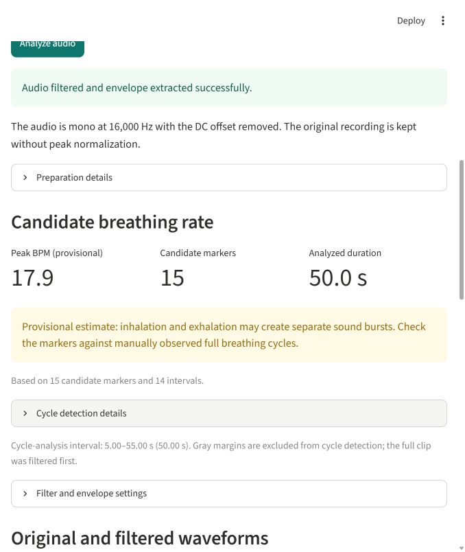
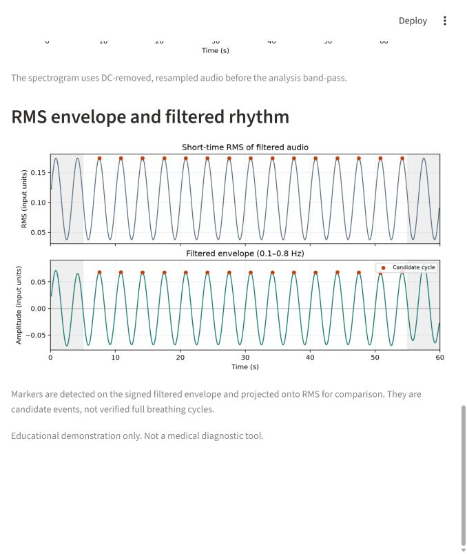

# Midterm presentation content

Prepared 27 November 2026 for the working midterm target of 28 November 2026. Six slides, approximately six minutes plus a short GUI demo. This is copyable slide content, not a rendered slide deck.

**Milestone:** M5 preparation complete with the real-recording pilot deferred by user instruction. **Validation status:** partial. All numerical results below are generated-signal engineering checks. No real breathing accuracy, manual reference results, or microphone hardware verification is claimed.

## Slide 1 — Problem and prototype objective

**GUI App for Contactless Respiration-Rate Estimation from Audio Using DSP**

- Repeated breathing sounds may reveal the rate of complete breathing cycles.
- Noise, microphone position, and separate inhale/exhale sounds can make detection difficult.
- Our current prototype accepts a WAV or microphone input and visualizes the DSP stages.
- It produces a provisional peak-based rate estimate through a browser GUI.
- Educational demonstration; not a medical diagnostic tool.

Speaker note: The software prototype is working. Real recordings and manual cycle comparisons are the next validation task; today's numerical examples use generated acoustic signals.

## Slide 2 — Implemented signal-processing pipeline

WAV / microphone input → validation → mono and DC removal → 16000 Hz resampling → audio band-pass → short-time RMS → slow envelope band-pass → central interval → candidate peaks → provisional BPM.

- Original audio is retained for playback and saving.
- RMS = square root of the mean squared samples in each frame.
- Candidate times give consecutive intervals; BPM = 60 / median(intervals in seconds).
- At least three markers are required. Unsupported estimates return Unavailable with a reason.

Speaker note: The median reduces the effect of an occasional long interval. It cannot determine whether two regular sound bursts belong to one breath.

## Slide 3 — Filter and detection choices

| Operation | Actual setting | Starting rationale |
| --- | --- | --- |
| Audio band-pass | 100–2000 Hz | Reduce rumble and content outside the chosen acoustic band |
| RMS extraction | 250 ms window; 50 ms hop | Smooth short fluctuations while retaining a 20 Hz envelope |
| Envelope band-pass | 0.1–0.8 Hz at 20 Hz | Search slow repetition corresponding to 6–48 BPM |
| Both band-passes | Butterworth IIR, SciPy N=2, SOS, forward-backward | Modest design parameter, stable representation, zero-phase filtering of completed clips |
| Peak selection | At least 1.25 s apart; prominence 0.15 × (P95−P5) | Limit close markers and small envelope fluctuations |
| Analysis interval | Exclude first/last 5 s after filtering the full clip | Reduce start/stop and edge influence |

Speaker note: 0.1–0.8 Hz is applied to the envelope, not the microphone waveform. N=2 creates a fourth-order band-pass per pass. Forward-backward filtering squares the magnitude response, with effective response order eight; nominal single-pass −3 dB cutoffs become approximately −6 dB. Settings are starting choices awaiting real-pilot inspection. The range is not a clinical definition of normal breathing, and five-second margins do not guarantee removal of every transient.

## Slide 4 — Working GUI

- Upload or recording controls, original metadata, playback, and Save original WAV.
- Original/filtered waveforms and acoustic spectrogram.
- Raw RMS, signed filtered envelope, candidate markers, and excluded margins.
- Provisional rate, candidate count, analyzed duration, and readable failure messages.

Actual app screenshots, captured during M2/M3 browser checks on generated signals:

Optional spectrogram image: [M2 spectrogram](screenshots/m2-spectrogram.png). These screenshots predate the M4 Save original WAV control and do not verify physical microphone capture or audible playback.

Speaker note: Demonstrate the app using the runbook. State that the displayed carrier tone is a generated engineering input before playing it.

## Slide 5 — Engineering checks and known limitation

Each clean check uses 60 seconds of amplitude-modulated 700 Hz audio and the central 5–55 second interval with default settings.

| Known modulation rate (BPM) | Peak estimate (BPM) | Absolute error (BPM) | Candidate markers |
| --- | --- | --- | --- |
| 12 | 12.00 | 0.00 | 10 |
| 18 | 17.91 | 0.09 | 15 |
| 24 | 24.00 | 0.00 | 20 |

- A two-burst full pattern at 12 BPM returns **24 BPM**: the current method can double count.
- A constant carrier returns Unavailable; silent audio is rejected.
- All 31 automated checks pass in the M5 audit, including GUI and DSP cases.
- These cases verify implementation behavior. They do not establish accuracy on people breathing.
- Real recordings, manual reference rates, and real-data error results are **pending**.

Speaker note: Do not describe the table as clinical accuracy, detection F1, or an SNR study. The double-burst failure is retained without automatic division by two. Results and settings are saved in [the engineering snapshot](midterm-engineering-snapshot.json).

## Slide 6 — Contributions and remaining work

**Contribution disclosure:** the planned two-member split is documented, but no verified individual contribution entries have been supplied. Both members must complete [the contribution log](templates/contributions.csv) with work they actually performed before presenting individual ownership. Implementation assistance is recorded in the handoff; it is not evidence of either member's work.

**Next work:**

1. Collect 2–3 real pilot clips and manual full-cycle references; check duplicate/missed events and starting settings.
2. Verify microphone capture and audible playback on the demo machine.
3. In the final phase, add independent autocorrelation and heuristic quality reporting.
4. Compare peak detection vs autocorrelation quantitatively, including valid-estimate coverage.
5. Evaluate added white noise at 20, 10, 5, 0, and −5 dB with three seeds; report error vs SNR.
6. Complete report, individual contributions, and viva preparation.

Speaker note: The software milestone is packaged; real-data validation is deferred. Final-stage features have not been implemented. Both members should be able to explain the full pipeline and report the work they personally completed.
